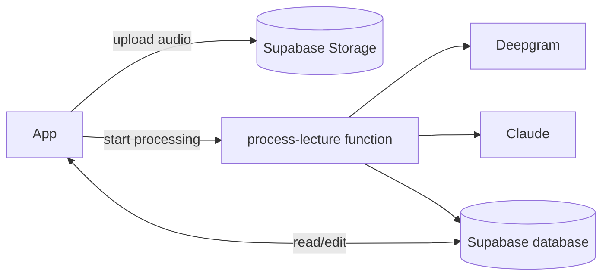

# Architecture

## Stack

- App: Expo (React Native), works on Android and iPhone
- Backend: Supabase (login, database, file storage, edge functions)
- Transcription: Deepgram (gives us speaker labels and timestamps)
- Notes, to-dos, flashcards, study plan: Claude Sonnet 5

Everything is on free tiers except Claude, which is a few dollars of prepaid credit. We picked Supabase over Firebase because Firebase needs a paid plan for file storage.

API keys are only stored in Supabase secrets, never in the app.

## How it works

1. Staff can invite students to a course by email
2. Staff record a lecture for that course in the app and it keeps recording in the background
3. The audio gets uploaded to Supabase
4. The `process-lecture` function sends it to Deepgram for a transcript
5. The transcript goes to Claude, which writes the summary, to-dos, key points, terms, flashcards, and study plan at a grade 6 reading level for students with intellectual disibilities.
6. Staff can edit the summary, transcript, and study plan, then mark the lecture verified
7. Students see verified lectures for their courses, review flashcards, and see reminders. There is a "read aloud" button on every screen.

## Database

- `profiles`: one per user. Has `role` (staff or student)
- `courses`: name and owner (staff)
- `course_members`: students invited to a course, by email. The student doesn't need an account yet
- `lectures`: course, title, date, audio file, status, transcript, notes (summary, to-dos, key points, terms), study plan, verified
- `flashcards`: front and back, one row per card
- `flashcard_reviews`: each student's own schedule for each card (when it's due next)
- `reminders`: title, time, and the email of the student it's for

Access rules (RLS):
-Staff can see and edit their own corses, lectures, flashcards, invites, and reminders.
-Students see the courses they werte invited too and see verified lectures and flascards for that course.
- Students see reminders sent to their email and manage their own flashcard reviews

Screens should get data through functions in `src/lib/api.ts` instead of calling Supabase directly.

## Features

| Requirement | Status |
|---|---|
| FR-1a Android app | Development build working. Need to upload to play internal track still |
| FR-2 Audio recorder | Start, pause, resume, stop, timer, background recording, and saved to a specific course |
| FR-3 Reminders | Staff can make reminders for individual students |
| FR-4 Study plan | Claude writes the plan, then staff can edit it |
| FR-5 Transcription | Deepgram, with speakers and timestamps, editiable by staff. |
| FR-6 Note converter | Claude writes the notes. Staff verify them before they are shown to students |
| Flashcards | Spaced repetition: if the student answers got it, its a 1 day wait. If they answer again it's reset to one day |
| Read aloud | TTS button on lecture notes, flashcards, and reminders |

Everything is on the API tests tab for now.
