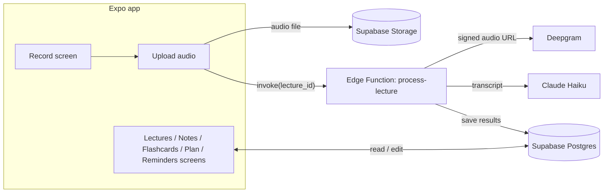

# Architecture & Team Stories (DRAFT)

Team 10: Andreas / Fisher / Traggic. This doc says what we're building, which services we use, and who builds what.

## The stack

| Piece | Service | Why | Cost |
|---|---|---|---|
| App | **Expo (this repo)** | One codebase for Android (FR-1a) and iOS (FR-1b) | Free |
| Login | **Supabase Auth** (email + password) | Built in. Works with Expo. | Free |
| Database | **Supabase Postgres** | Tables you can view and edit in a web dashboard, like a spreadsheet | Free |
| Audio files | **Supabase Storage** | Same dashboard, same login rules | Free (1 GB) |
| Server code | **Supabase Edge Function** (one function: `process-lecture`) | Holds our API keys so they never ship in the app | Free |
| Transcription | **Deepgram** (Nova-3, `diarize=true`) | Gives speaker labels and timestamps (FR-5). An hour of audio returns in well under a minute. | $200 free credit, no card |
| Notes / flashcards / study plan | **Claude Haiku** via the Anthropic API | One call turns a transcript into JSON: summary, vocab, flashcards, plan (FR-6, FR-4) | About $5 prepaid. Prepaid credit is a hard spending cap. |

**Why not Firebase:** file storage and calls to outside APIs from Cloud Functions both need the Blaze (credit card) plan, and Blaze has no hard spending cap.
**Why not our own GCP functions:** we'd have to build auth, the database and storage ourselves.
**Watch out:** a free Supabase project pauses after 7 days with no activity. Click "Restore" in the dashboard.

## How it fits together

**Pipeline (one lecture):** record → upload → transcribe → generate notes, flashcards and plan → staff verify and edit → student studies.

**For P2:** this is **client–server** built on a managed backend (BaaS), with a **pipe-and-filter** processing pipeline (FR-2 → FR-5 → FR-6 → FR-4). How the NFRs map:
- *Data stewardship:* Supabase row-level security, so users see only their own data or their students' data. API keys stay on the server. We don't use a provider that trains on our data.
- *WCAG / text-to-speech:* runs on the phone (`expo-speech`), so it needs no backend.
- *No commercial use:* free tiers only. No payments code.

## Data (5 tables)

| Table | Key columns |
|---|---|
| `profiles` | `id` (= auth user), `name`, `role` (`staff` or `student`), `supporter_id` (the student's staff member) |
| `courses` | `id`, `owner_id`, `name` |
| `lectures` | `id`, `course_id`, `owner_id`, `title`, `date`, `audio_path`, `status` (`uploaded`, `processing`, `ready` or `error`), `transcript` (json), `notes` (json), `verified` |
| `flashcards` | `id`, `lecture_id`, `front`, `back`, `due_at`, `interval_days` |
| `reminders` | `id`, `student_id`, `created_by`, `title`, `remind_at` |

The study plan is stored as a json column on `lectures` (or as its own table later if we need it).

**Rule for screens:** screens never call Supabase directly. They import functions from `src/lib/api.ts`, for example `listLectures()`, `getLecture(id)` and `saveFlashcardReview(id, correct)`. Trent writes that file first, so everyone else only builds screens.

---

## Stories

Each story says: **Goal → Steps → Done when.** Branch name `story-N`, then open a PR and ask Trent to review it.
Sprint 1 ends around 10/18. Sprint 3 ends about 11/15 (MVP demo to the TA).

### Trent: plumbing

**1. Backend setup (Sprint 1)**
Create the Supabase project, the tables above and their row-level-security rules, and `src/lib/supabase.ts` + `src/lib/api.ts`. Add sign-in and sign-up screens.
*Done when:* a teammate can sign up in the app and their row shows up in the dashboard.

**2. Record & upload (FR-2, Sprint 1)**
The record screen uses `expo-audio` (start, pause, resume, stop, timer). Record in mono at a low bitrate so an hour stays under 50 MB. On stop, pick the course, upload the file and create the `lectures` row.
*Done when:* a 5-minute recording appears in Storage and in the `lectures` table.

**3. `process-lecture` function (FR-5, FR-6, FR-4, Sprint 2)**
The function takes Deepgram's transcript and sends it to Claude, which returns JSON (summary, vocabulary, flashcards, study plan). It saves the results and sets `status = ready`.
*Done when:* a real 50-minute lecture ends up `ready`, with notes and flashcards.

**4. Android test build (FR-1a, Sprint 3)**
Create an EAS build and put it on the Play internal test track.

### Evan: study screens

**5. Courses & lectures list (Sprint 1)**
Home screen: your courses, then the lectures in each course, with a status badge ("Processing…" or "Ready").
*Steps:* copy the pattern in `src/app/index.tsx`. Get the data from `api.listLectures()`. Use the fake data in `api.ts` until Story 1 is merged.
*Done when:* you can tap a course to see its lectures, then tap a lecture to open it (an empty screen is fine for now).

**6. Lecture detail + verify (FR-5, FR-6, Sprint 2)**
Tabs for Transcript (speaker and timestamp on each line) and Notes. Staff can edit the text and press **Mark verified**.
*Done when:* edits save, and the verified check stays after you restart the app.

**7. Flashcard review (Sprint 2–3)**
Show the front of a card, tap to flip, then answer "Got it" or "Again". "Got it" doubles `interval_days`; "Again" resets it to 1. Show only cards that are due.
*Done when:* the cards you answered "Got it" don't show up again until they're due.

### Jared: support features

**8. Reminders (FR-3, Sprint 2)**
A form with a title, date and time, plus a student picker (staff only). Save to `reminders`. On app open, the student's phone schedules local notifications with `expo-notifications`.
*Done when:* a reminder that staff create on one phone shows up as a notification on the student's phone.

**9. Study plan screen (FR-4, Sprint 2–3)**
Show the generated plan as sections with checkboxes. Staff can reorder or delete sections and add notes. Each section has an "Add reminder" button that links to Story 8.
*Done when:* staff edits are saved and the student sees the same plan.

**10. Read-aloud button (WCAG NFR, Sprint 3)**
A reusable `<ReadAloud text={...} />` button using `expo-speech`. Add it to every screen that has text, and give every image and icon an `accessibilityLabel`.
*Done when:* every text screen can be read aloud.

### Everyone
- Put the stories into **Jira** (required by the course) exactly as written above.
- Before marking a story done, test it on a real phone using Expo Go or the dev build.
