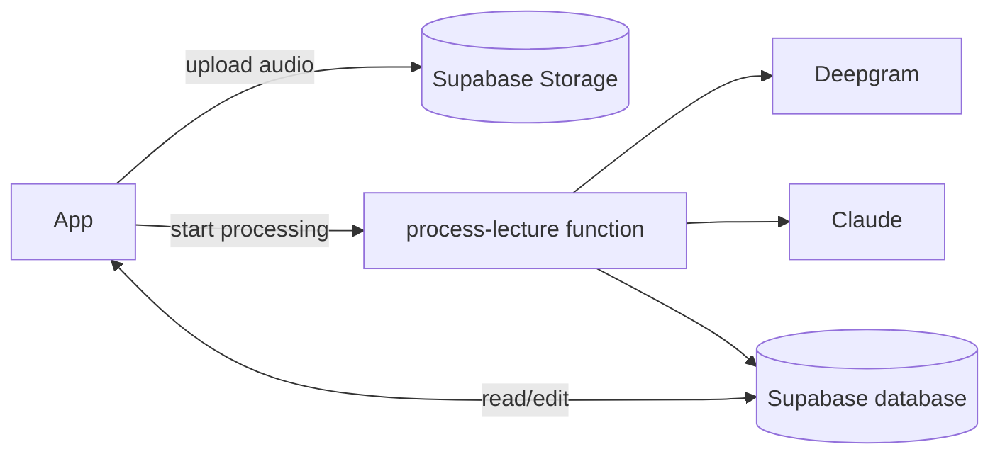

# Architecture

## Stack

- App: Expo (React Native), works on Android and iPhone
- Backend: Supabase (login, database, file storage, edge functions)
- Transcription: Deepgram (gives us speaker labels and timestamps)
- Notes, flashcards, study plan: Claude Haiku

Everything is on free tiers except Claude, which is a few dollars of prepaid credit. We picked Supabase over Firebase because Firebase needs a paid plan for file storage.

API keys are only stored in Supabase secrets, never in the app.

## How it works

1. Staff records the lecture in the app
2. The audio gets uploaded to Supabase
3. The `process-lecture` function sends it to Deepgram for a transcript
4. The transcript goes to Claude, which makes the notes, flashcards, and study plan
5. Everything gets saved to the database and shows up in the app
6. Staff checks the notes and marks them verified, then the student can study them

## Database

- `profiles`: one per user. Has `role` (staff or student) and `supporter_id` (the student's staff member)
- `courses`: name and owner
- `lectures`: course, title, date, audio file, status, transcript, notes, study plan, verified
- `flashcards`: front, back, and when it's due next
- `reminders`: title, time, and which student it's for

Users can only see their own data. Staff can also see their students' data.

Screens should get data through functions in `src/lib/api.ts` instead of calling Supabase directly.

## Stories

### Trent
1. Supabase setup, login/signup screens, `api.ts`
2. Record screen (start, pause, stop, timer) and upload the audio
3. `process-lecture` function (Deepgram + Claude)
4. Android test build

### Evan
5. Home screen: list of courses, then lectures in each course with a status (processing / ready)
6. Lecture screen: transcript and notes tabs. Staff can edit and mark it verified
7. Flashcard review: flip the card, then "got it" or "again". "Got it" pushes the card further out

### Jared
8. Reminders: staff makes a reminder for a student and it shows up as a notification on the student's phone
9. Study plan screen: sections with checkboxes, staff can edit them and add reminders
10. Read aloud button (text to speech) on every screen with text, for accessibility

Put these in Jira. Test on your phone before marking anything done.
